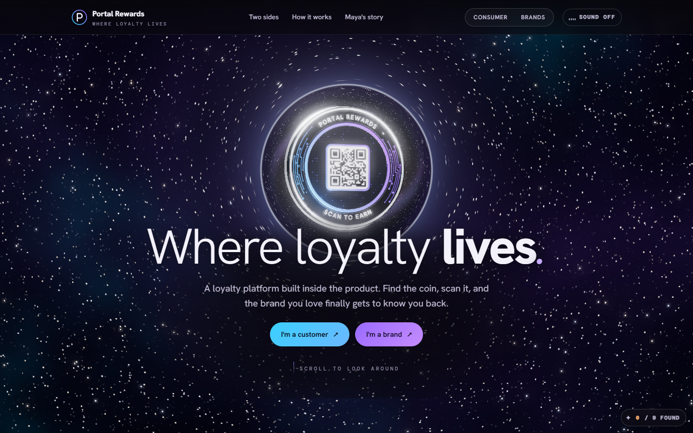
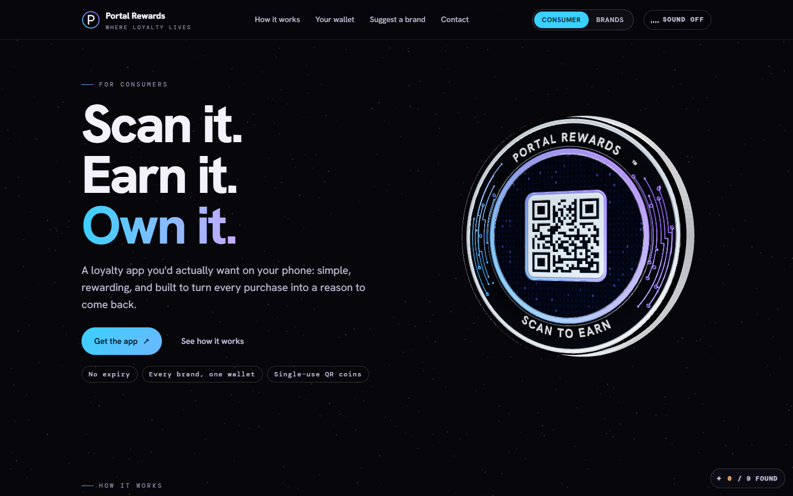
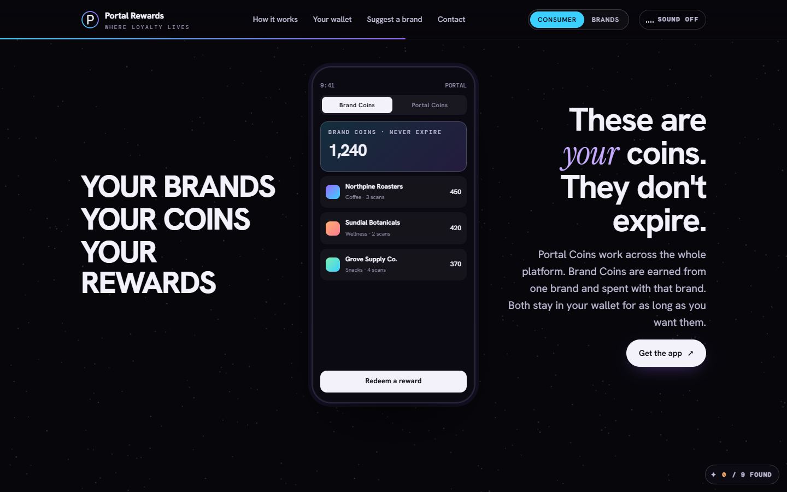
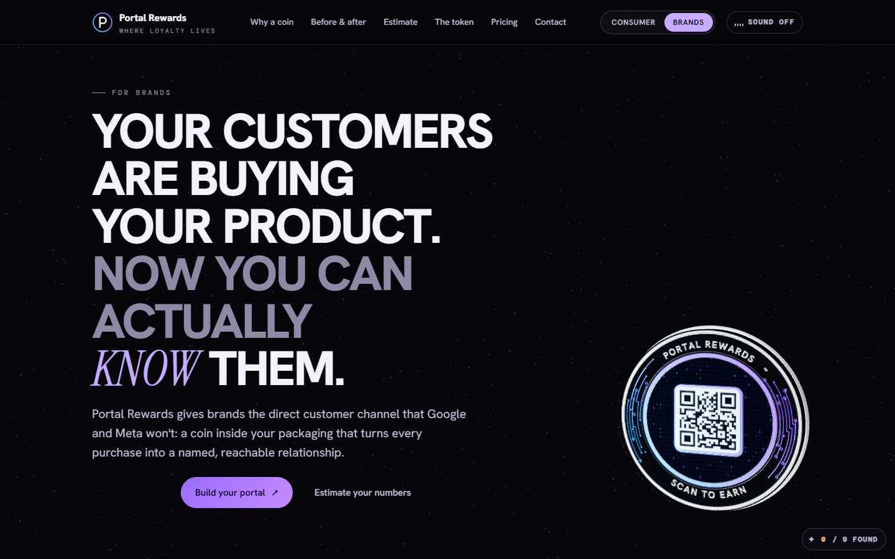
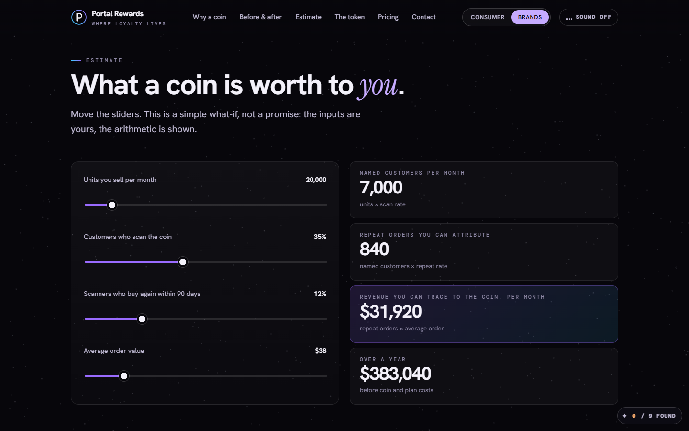
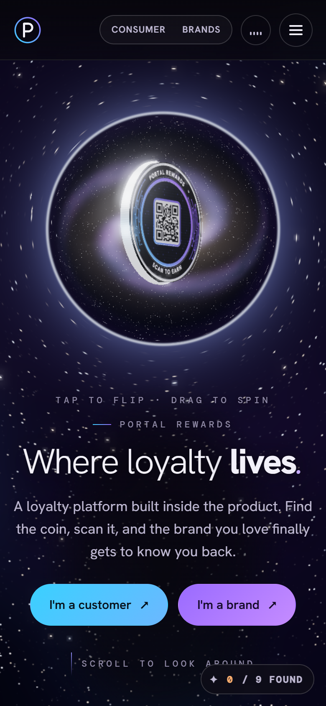

# Portal Rewards

**Where loyalty lives.** A single-page, 3D landing experience for Portal Rewards, a loyalty platform built into the product itself. Find the coin on the pack, scan it, and the brand gets a named, reachable relationship with you.

The page is plain HTML, CSS and JavaScript with no framework. A WebGL scene (three.js) renders the portal tunnel, the starfield and the coin. The page follows two routes: one for consumers and one for brands. Picking a side flies the camera through the portal.



## Screenshots

| For consumers | Your wallet |
| --- | --- |
|  |  |
| **For brands** | **Estimate calculator** |
|  |  |

<p align="center">
  
  <br><sub>Fully responsive: the home page on a 390px-wide phone.</sub>
</p>

## Features

- **3D portal and coin.** Built with three.js, with bloom post-processing. Tap the coin to flip it, drag to spin it. The coin follows you down the page.
- **Two sides, one page.** Hash routes (`#home`, `#consumer`, `#brand`, plus section anchors such as `#calc` or `#pricing`) switch views without a server.
- **Interactive pieces.** A brand-coin wallet demo, a "suggest a brand" form, a before-and-after comparison, and a what-if revenue calculator.
- **Small extras.** Optional synthesised sound, a custom cursor, hidden "discoveries" to find (0 / 9 found), and a 2D coin fallback when WebGL isn't available.

## Project structure

```
source/                  The page, split into parts (edit these)
  part1-style.html       <title>, fonts and all CSS
  part2-markup.html      the markup for every page and section
  part3a-coin.js         three.js setup and the coin
  part3a-wormhole.js     the portal tunnel (default)
  part3a-gate.js         the earlier "Gate" portal: metal ring and chevrons
  part3b-page.js         routing, sound, demos, forms, calculator
public/                  copied as-is into the build (favicon, social preview image)
docs/screenshots/        the images in this README
build.mjs                joins source/ into one page (no dependencies)
vercel.json              Vercel build and header settings
portal-rewards.html      prebuilt single file: double-click to open it locally
```

## Run it locally

You need Node.js 18 or newer. The project has no npm dependencies.

```bash
npm run build      # writes dist/index.html and refreshes portal-rewards.html
npm run dev        # builds, then serves dist/ at http://localhost:3000
npm run build:gate # same build, using the "Gate" portal instead of the wormhole
```

Or just double-click `portal-rewards.html` and it opens in Chrome or Edge. It needs an internet connection, because three.js, the QR library and the Google fonts load from public CDNs.

## Deploy to Vercel

The repo is ready to deploy as-is. `vercel.json` sets the build command (`npm run build`) and the output directory (`dist`).

**From the dashboard:**

1. Push this repo to GitHub.
2. In Vercel, choose **Add New → Project** and import the repo.
3. Leave the settings as they are (Framework Preset: *Other*). `vercel.json` takes care of the rest.
4. Click **Deploy**.

**From the CLI:**

```bash
npm i -g vercel
vercel          # preview deployment
vercel --prod   # production deployment
```

When Vercel builds the site, `build.mjs` uses the project's production domain (`VERCEL_PROJECT_PRODUCTION_URL`) to write absolute URLs for the Open Graph and Twitter preview tags. That way links shared in Slack, X or iMessage show `public/og-image.png`. If you use a custom domain, set a `SITE_URL` environment variable (for example `https://portalrewards.com`) to use that domain instead.

## Live prototype

A hosted copy of the prototype (private until shared): https://claude.ai/artifact/SyvRXSS6Rw7B8Di3hexNun
